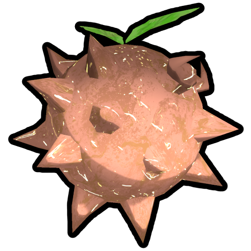
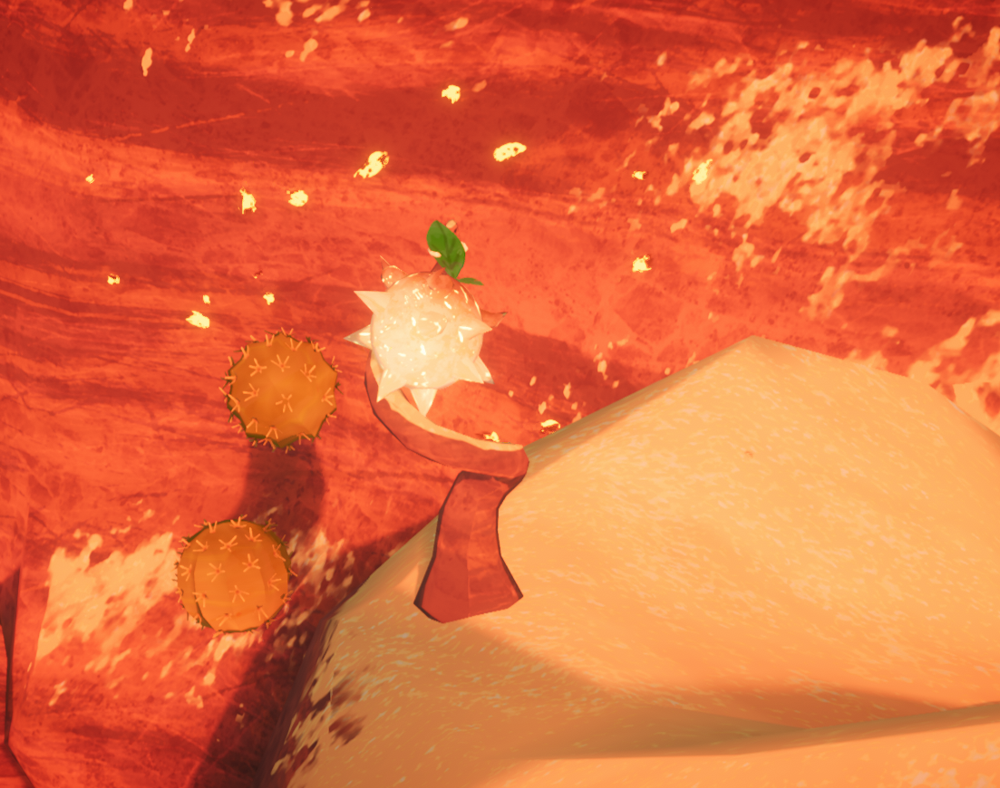

# WakeBerry #
Adds a new [  Napberry](https://peak.wiki.gg/wiki/Napberry) counterpart to [MESA](https://peak.wiki.gg/wiki/Mesa)!

## 🍓 The Sun Berry ##
Meet the Wakeberry, [MESA](https://peak.wiki.gg/wiki/Mesa)'s fiery counterpart to the [  Napberry](https://peak.wiki.gg/wiki/Napberry).

<figure>
    
</figure>

Rarity
: Legendary

Location
: Wakeberry Plants ([MESA](https://peak.wiki.gg/wiki/Mesa))

Tags
: [Berry](https://peak.wiki.gg/wiki/Berry_(disambiguation)), [Natural Food](https://peak.wiki.gg/wiki/Food#Natural_food)

As the name suggests, this sun-shaped berry can bring an [unconscious scout](https://peak.wiki.gg/wiki/Scout#Unconscious_state_&_Death) back into consciousness.

## How it works ##
Wakeberries grows on Wakeberry Plants near [ dynamite](https://peak.wiki.gg/wiki/Dynamite) in the [MESA](https://peak.wiki.gg/wiki/Mesa). If you spot one, don't take too long to pick it:
**looking at or being near an unpicked Wakeberry Plant gives [ Heat](https://peak.wiki.gg/wiki/Stamina_bar#Heat)**!

<figure>
  
  <figcaption>A Wakeberry Plant on a ledge near two <a href="https://peak.wiki.gg/wiki/Cactus/"> Cactus</a></figcaption>
</figure>

### Baseline stat ###
| Stat                                                                                                                                                                                                                                                             | Amount |
|------------------------------------------------------------------------------------------------------------------------------------------------------------------------------------------------------------------------------------------------------------------|--------|
|   | −30%   |
|  | −100%  |
|   | +2.5%  |

The Wakeberry always restore [ Hunger](https://peak.wiki.gg/wiki/Stamina_bar#Hunger) in a similar way to that of a [ Purple Kingberry](https://peak.wiki.gg/wiki/Purple_Kingberry). The main effect depend on the condition of the [scout](https://peak.wiki.gg/wiki/Scout) eating it.

### Feeding an [unconscious](https://peak.wiki.gg/wiki/Scout#Unconscious_state_&_Death) [scout](https://peak.wiki.gg/wiki/Scout) ###

Feeding a Wakeberry to a fully (or soon to be) _[unconscious](https://peak.wiki.gg/wiki/Scout#Unconscious_state_&_Death)_ [scout](https://peak.wiki.gg/wiki/Scout) will **forcibly wake them up!**

To do this, it removes [status effets](https://peak.wiki.gg/wiki/Stamina_bar#Status_effects) one by one (starting with the most severe, keeping [ Weight](https://peak.wiki.gg/wiki/Stamina_bar#Weight) for last) until the [scout](https://peak.wiki.gg/wiki/Scout) regains consciousness.

Any [status effets](https://peak.wiki.gg/wiki/Stamina_bar#Status_effects) that can make [scouts](https://peak.wiki.gg/wiki/Scout) [unconscious](https://peak.wiki.gg/wiki/Scout#Unconscious_state_&_Death) can be cured.

[Status effets](https://peak.wiki.gg/wiki/Stamina_bar#Status_effects) that can come with sticky things (like [ Thorns](https://peak.wiki.gg/wiki/Stamina_bar#Thorns), [ Poison](https://peak.wiki.gg/wiki/Stamina_bar#Poison)) will also drop those when cured.

Likewise, any [status effets](https://peak.wiki.gg/wiki/Stamina_bar#Status_effects) that traps [scout](https://peak.wiki.gg/wiki/Scout) (like [ Web](https://peak.wiki.gg/wiki/Stamina_bar#Web)) will free [unconscious](https://peak.wiki.gg/wiki/Scout#Unconscious_state_&_Death) [scouts](https://peak.wiki.gg/wiki/Scout) when cured.

Finally, if [ Weight](https://peak.wiki.gg/wiki/Stamina_bar#Weight) is the [status effets](https://peak.wiki.gg/wiki/Stamina_bar#Status_effects) getting "cured", [unconscious](https://peak.wiki.gg/wiki/Scout#Unconscious_state_&_Death) [scout](https://peak.wiki.gg/wiki/Scout) might drop their [ Backpack](https://peak.wiki.gg/wiki/Backpack) automatically, along with **any items still in their inventory**, so keep that in mind.

### Feeding a conscious [scout](https://peak.wiki.gg/wiki/Scout) ###
Feeding a Wakeberry to a _conscious_ [scout](https://peak.wiki.gg/wiki/Scout) will give the following [Status effets](https://peak.wiki.gg/wiki/Stamina_bar#Status_effects):

| Stat                                                                                                                                                                                                                                                                                  | Amount |
|---------------------------------------------------------------------------------------------------------------------------------------------------------------------------------------------------------------------------------------------------------------------------------------|--------|
|                                | +100%  |
|  | +12.5% |

When fed to a _conscious_ [scout](https://peak.wiki.gg/wiki/Scout), the Wakeberry **does NOT cure any additional [status effets](https://peak.wiki.gg/wiki/Stamina_bar#Status_effects)!** 

## 🌵 How it spawns ##
Wakeberries hangs form Wakeberry Plants, which have a small chance _(~5%)_ of replacing [ dynamite](https://peak.wiki.gg/wiki/Dynamite) that isn't inside [mine shafts](https://peak.wiki.gg/wiki/Mesa#Mine_Shafts).
There can be at most **up to 5 Wakeberry Plants** per [MESA](https://peak.wiki.gg/wiki/Mesa). There's also a chance of them not spawning at all.

Where they spawn depend on the map's seed and how many times the game has cycled through its maps. The same map can
therefore have different Wakeberry Plants locations depending on which cycle you encounter the map.

For example, everytime the first map (_Level_0_) is the daily map, Wakeberry Plants will be somewhere
different. However, if you replay _Level_0_ later on _the same day_ (or on the same cycle), they'll be at the same spot everytime.

**Beware!** Like [  Napberries](https://peak.wiki.gg/wiki/Napberry) and [ dynamite](https://peak.wiki.gg/wiki/Dynamite), Wakeberry Plants can sometime spawn **INSIDE WALLS**. 
If you encounter one, you'll need to navigate around it, taking care not to take much [ Heat](https://peak.wiki.gg/wiki/Stamina_bar#Heat) damage.